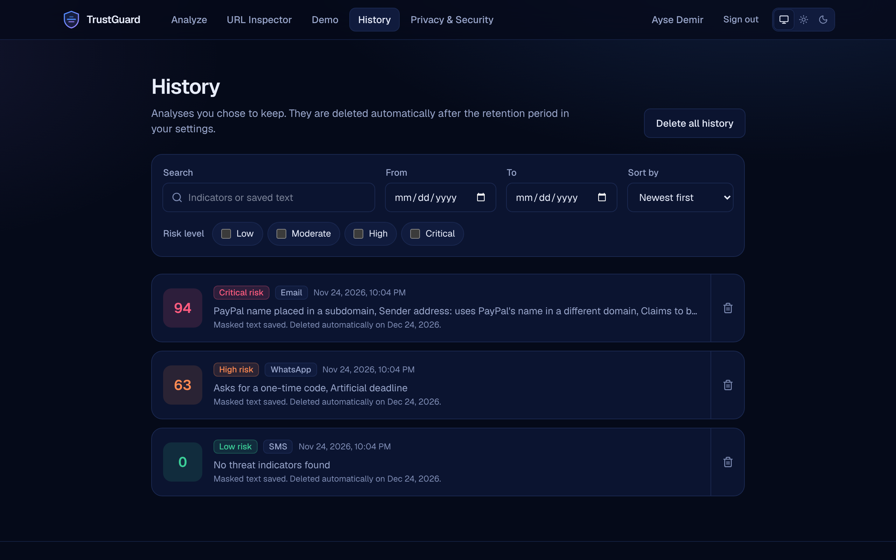
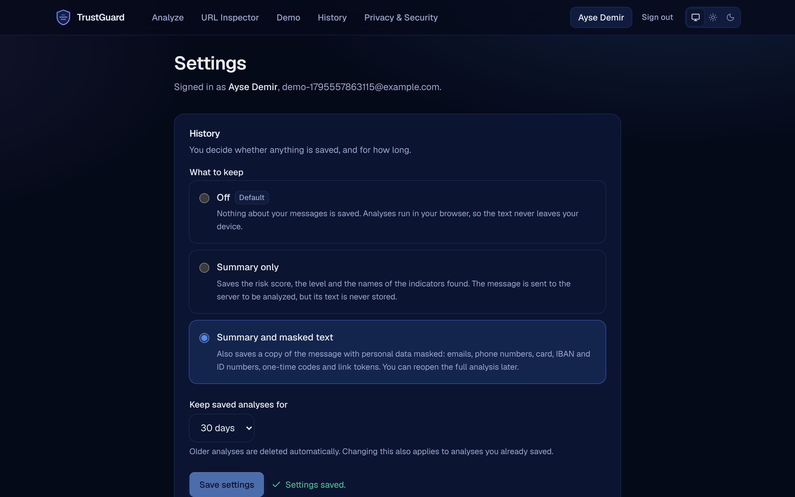
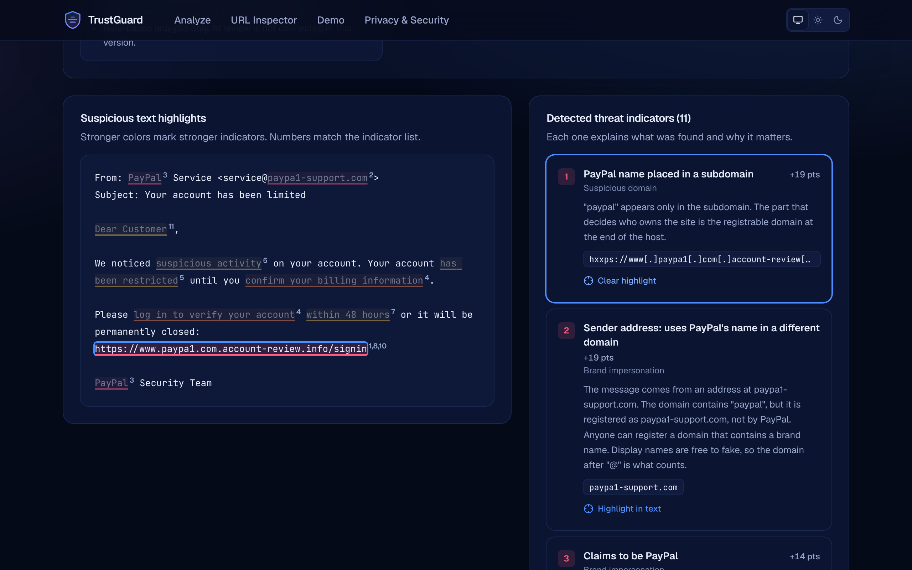
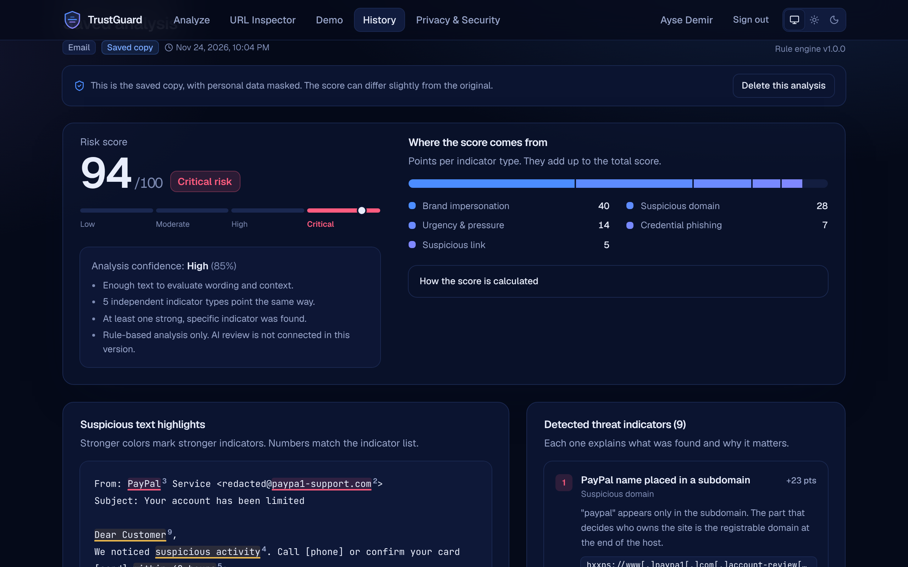
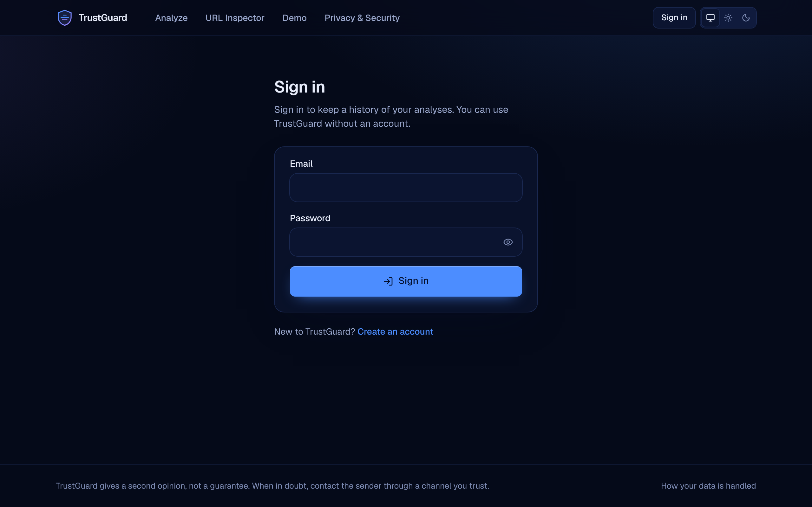
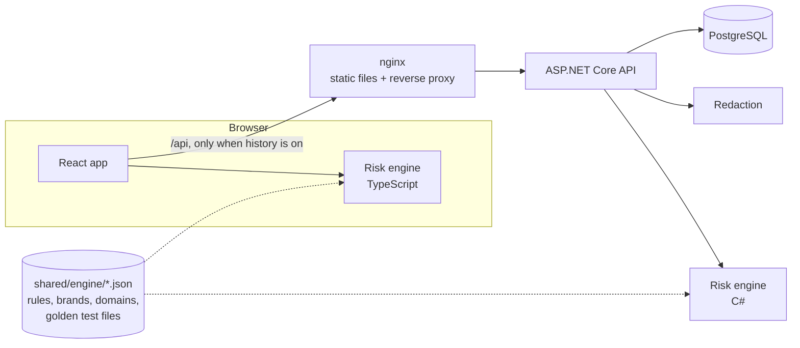

# TrustGuard

**Think before you trust.**

TrustGuard checks suspicious messages and links (SMS, email, WhatsApp, job offers, URLs) for scam patterns. It shows *which words* triggered each warning, *how many points* each one added, and *what to do next*, and it is built so that your message stays private by default.

[](https://github.com/bilgee777/trustguard/actions/workflows/ci.yml)
[](https://github.com/bilgee777/trustguard/actions/workflows/codeql.yml)


> **Project status: phases 1 and 2 of 4 are done.** The React app, the rule-based risk engine (in TypeScript *and* C#), the ASP.NET Core API, PostgreSQL storage, accounts and opt-in history all work and are tested. AI review, screenshot OCR, the security dashboard and the Azure deployment are next ([roadmap](#roadmap)). The interface never presents a feature that does not exist yet.

---

## Why this exists

Most scam checkers return a number from a black box. TrustGuard is built on three ideas:

1. **Explainable over impressive.** Every point in a score traces back to a named rule, and the points add up exactly to the total.
2. **Hybrid, not AI-only.** A deterministic rule engine gives a reproducible baseline that cannot be prompt-injected. AI review (phase 3) will be a separate, labelled opinion on top.
3. **Private by architecture.** By default the message is analyzed **in your browser** and never sent anywhere. It reaches the server only if you sign in *and* turn history on, and personal data is masked before anything is stored.

## Features

| | |
|---|---|
| **Threat analyzer** | Paste a message, pick its type and get a 0 to 100 score, a risk level, analysis confidence and recommended actions. |
| **Evidence highlights** | The message with every suspicious phrase marked. Selecting an indicator highlights its text, and footnote numbers link the two. |
| **Score breakdown** | A stacked bar showing how many points each indicator type contributed. |
| **URL Inspector** | Takes a link apart without opening it: real owner, hidden `@` destinations, punycode and homoglyph domains, look-alike brands, IP hosts, shorteners. |
| **Interactive demo** | Six fictional scenarios, from a fake remote job to a legitimate shipping notice, analyzed live by the same engine. |
| **Accounts** | Sign up, sign in, session renewal, sign out, account deletion. |
| **Opt-in history** | Off by default. Keep a summary, or a copy with personal data masked. Filter by risk level and date, search, sort, page and delete. You pick the retention period. |
| **Accessible and responsive** | WCAG 2.1 AA checked by axe in both themes, full keyboard support, screen-reader labels, 390 px and up. Light, dark and system theme. |

<table>
  <tr>
    <td></td>
    <td></td>
  </tr>
  <tr>
    <td></td>
    <td></td>
  </tr>
  <tr>
    <td></td>
    <td></td>
  </tr>
</table>

## Architecture



**Two engines, one contract.** The browser runs the TypeScript engine so a message never has to leave the device. The server runs a C# port so it can store results and, later, add AI review. Both read the same rule data from [`shared/engine`](shared/engine), and both are tested against the same golden file (105 messages, 148 URLs): every score, finding, text span and explanation must match exactly. A naive port would not: .NET's `\b`, `\d`, `\s` and `.` mean different things from JavaScript's, and a plain `new Regex(jsPattern)` scores 6 of the 105 test messages differently. Details in [docs/risk-engine.md](docs/risk-engine.md).

More: **[docs/architecture.md](docs/architecture.md)** (decisions and trade-offs), **[docs/api.md](docs/api.md)** (endpoints and error contract), **[docs/database.md](docs/database.md)** (schema and indexes).

## Security and privacy design

- **Message stays local by default.** Anonymous use and history-off analyses run entirely in the browser. Every result says where it was produced.
- **Opt-in storage with masking.** Cards (Luhn-checked), IBANs, phone and ID numbers, one-time codes, email addresses (domain kept) and link passwords and query values are masked *before* storage. Stepping down a history mode deletes what was stored.
- **Sessions.** `HttpOnly` + `SameSite=Strict` cookies, 15-minute access tokens, hashed refresh tokens with rotation and reuse detection (a replayed token revokes its whole session family), account lockout, PBKDF2 password hashing.
- **CSRF.** Double-submit token plus an `Origin` check, on top of `SameSite=Strict`. The web server proxies `/api`, so cookies are first-party and no CORS exists to misconfigure.
- **Untrusted input.** No HTML injection path (highlights are offsets, rendered as React text), bounded regexes with a timeout, size limits at nginx and in the API, parameterized queries through EF Core, uniform `application/problem+json` errors that never leak internals.
- **Links are never fetched.** URLs are inspected as text, and shown defanged (`hxxps://evil[.]com`).
- **Hardened containers.** Non-root users, read-only filesystems, all Linux capabilities dropped, `no-new-privileges`, the database reachable only from the API, a strict CSP with `connect-src 'self'`.
- **Supply chain.** Dependabot, CodeQL, `npm audit` and NuGet vulnerability checks in CI. See [SECURITY.md](SECURITY.md).

## Tech stack

| Layer | Choice |
|---|---|
| Web | React 19, TypeScript 6 (strict), Vite 8, Tailwind CSS 4, React Router, TanStack Query, Zustand, Lucide icons |
| API | ASP.NET Core 10 (minimal APIs), EF Core 10, Npgsql, JWT in HttpOnly cookies, built-in rate limiting, OpenAPI |
| Database | PostgreSQL 18 (local and in CI), Neon works out of the box |
| Testing | Vitest and Testing Library, xUnit with Testcontainers (real PostgreSQL), Playwright and axe-core |
| Quality | ESLint (`strictTypeChecked`, react-hooks, jsx-a11y), Prettier, .NET analyzers as errors, CodeQL |
| Delivery | Docker (nginx, .NET runtime), Docker Compose, GitHub Actions |
| Planned | Azure OpenAI behind a provider-independent interface, OCR, Azure Container Apps |

## Getting started

### Option A: everything in Docker

Requires Docker with Compose.

```bash
cp .env.example .env
```

Open `.env` and fill in `POSTGRES_PASSWORD` and `JWT_SIGNING_KEY` (the file explains how to generate them, for Windows PowerShell too). Then:

```bash
docker compose up --build
```

Open http://localhost:8080. Compose starts PostgreSQL, the API (applying migrations on start) and the web server, waits for each healthcheck, and publishes only the web server, on `127.0.0.1`.

### Option B: develop each part

Requires Node 22+, .NET 10 SDK and a PostgreSQL database (a Docker container, or a free [Neon](https://neon.tech) branch).

```bash
cd api/src/TrustGuard.Api
dotnet user-secrets set "ConnectionStrings:Default" "Host=localhost;Database=trustguard;Username=trustguard;Password=..."
dotnet run
```

In Development the API creates its tables on startup and uses a random signing key per run. In a second terminal:

```bash
cd web
npm ci
npm run dev
```

Open http://localhost:5173. Vite forwards `/api` to the API on port 5149 (override with `API_URL`).

### Configuration

| Variable | Meaning | Default |
|---|---|---|
| `ConnectionStrings__Default` | PostgreSQL connection (keyword string or `postgresql://` URL) | required |
| `ConnectionStrings__Migrations` | Direct, non-pooled connection used to apply migrations | falls back to `Default` |
| `Jwt__SigningKey` | Session token signing key, 32+ characters | required (random in Development) |
| `Cookies__Secure` | Mark cookies `Secure` | `true` |
| `Database__MigrateOnStartup` | Apply migrations when the API starts | `false` (`true` in Development and Compose) |
| `Security__TrustedProxyNetworks__N` | CIDR ranges whose `X-Forwarded-*` headers are trusted | none |
| `Security__AuthAttemptsPerMinute` | Sign-in and sign-up attempts per client per minute | `10` |
| `Security__AnonymousAnalysesPerMinute` / `AuthenticatedAnalysesPerMinute` | Analysis rate limits | `30` / `120` |
| `API_URL` (web dev server) | Where `/api` is proxied | `http://localhost:5149` |

Secrets are never committed: use user-secrets locally, `.env` for Compose (git-ignored), and a secret store such as Azure Key Vault in production.

## Testing

| Suite | Count | What it proves |
|---|---|---|
| Engine and UI unit tests (Vitest) | 178 | Scoring math, every URL check, false-positive guards, the golden-file contract, random-input fuzzing (3,000 inputs never crash the engine), form behavior, XSS safety |
| C# engine tests (xUnit) | 56 | The same behaviors, the golden file, a WHATWG URL parser checked against Node's on 148 URLs, 3,000-input fuzzing |
| API tests (xUnit + PostgreSQL) | 112 | Sessions, refresh rotation and reuse detection, lockout, CSRF and Origin checks, rate limits, every history and settings rule, data isolation between users, masking in the real database, retention, cascade deletion |
| End-to-end (Playwright) | 21 per viewport | User flows, keyboard-only use, axe WCAG 2.1 AA on every page in both themes, and the whole account lifecycle through web, API and database |

CI runs all of it on every push and pull request, plus a Docker job that builds both images, starts the Compose stack and smoke-tests it through nginx.

```bash
cd web && npm test                   # unit and component tests
cd api && dotnet test                # needs Docker for the API tests
cd web && npm run test:e2e           # anonymous flows and accessibility
```

The account E2E test needs the API and a database; set `E2E_API=1` and see `e2e-accounts` in [the workflow](.github/workflows/ci.yml).

## Deployment

The containers are production-shaped: health endpoints (`/api/health/live`, `/api/health/ready`), configuration only through environment variables, non-root users, read-only filesystems. The target is **Azure Container Apps** with Azure Database for PostgreSQL and secrets in Key Vault.

> The Azure deployment itself has not been run against a live subscription yet. It is part of phase 4, together with a verified automated pipeline. Behind a TLS-terminating ingress, set `COOKIES_SECURE=true` and configure the proxy networks so rate limits see real client addresses.

## Roadmap

- [x] **Phase 1:** React app, deterministic risk engine, URL Inspector, interactive demo, tests, CI
- [x] **Phase 2:** ASP.NET Core API, C# engine with exact parity, PostgreSQL, accounts, opt-in history with masking, rate limiting, Docker Compose, full CI
- [ ] **Phase 3:** Provider-independent AI review (Azure OpenAI adapter) on masked text, screenshot OCR, security dashboard
- [ ] **Phase 4:** Azure deployment (Container Apps and managed PostgreSQL), CD pipeline, monitoring

## Known limitations

- **Heuristics, not proof.** A low score means no known pattern matched. Tailored and novel scams can score low.
- **English-focused rules.** Messages in other languages get URL and character checks but few text matches.
- **Simplified domain parsing.** Registrable domains use a curated list of multi-part suffixes, not the full Public Suffix List.
- **Curated brand list.** Look-alike detection covers about 20 frequently impersonated brands.
- **No reputation data.** Domain age, blocklists and redirect chains need a server-side inspector with SSRF protection (planned).
- **Account trade-offs.** Registration reveals whether an email is taken, and failed sign-ins can lock an account for 15 minutes (see [SECURITY.md](SECURITY.md)).
- **No email verification or password reset yet.**
- **Browser and server engines can differ on astral characters** inside bounded regex windows (JavaScript counts code points, .NET counts UTF-16 units). The golden file covers emoji, and results matched.
- **Weights are hand-calibrated** against a small corpus, not learned from labelled data.

## Project structure

```
trustguard/
├── .github/                 CI, CodeQL, Dependabot
├── api/                     ASP.NET Core solution
│   ├── src/TrustGuard.Engine/   C# risk engine (no web dependencies)
│   ├── src/TrustGuard.Api/      endpoints, auth, history, redaction, EF Core migrations
│   └── tests/                   engine and API tests
├── web/                     React application, nginx config, Dockerfile
├── shared/engine/           rules, brands, domains and the golden files both engines read
├── db/schema.sql            idempotent SQL for the whole schema
├── docs/                    architecture, API, database, risk engine, screenshots
└── docker-compose.yml
```

---

The demo messages, names and domains are fictional and exist only to teach scam recognition.
