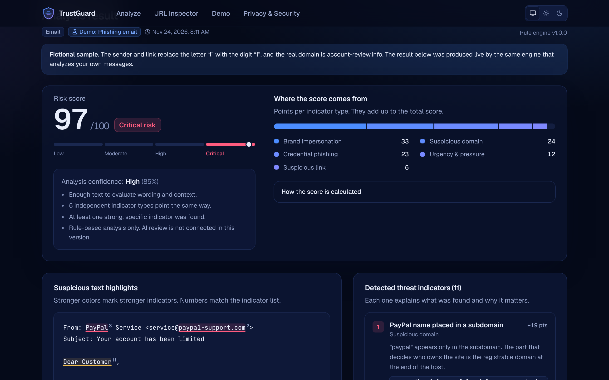
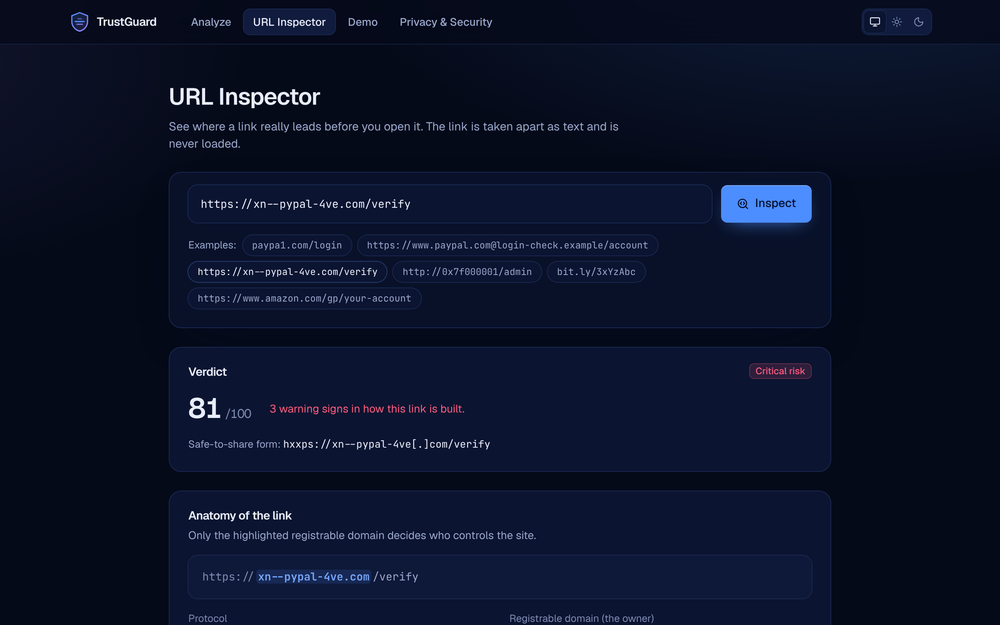
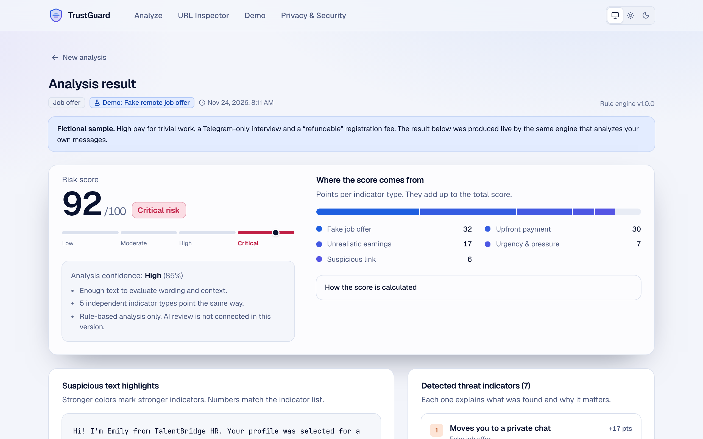
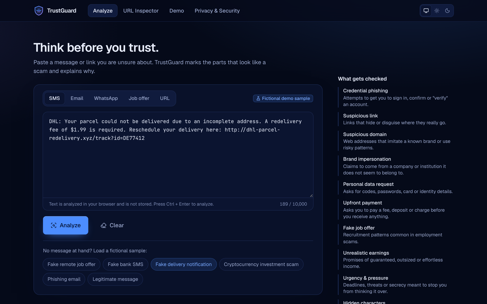

# TrustGuard

**Think before you trust.**

TrustGuard checks suspicious messages and links (SMS, email, WhatsApp, job offers, URLs) for scam patterns. It shows *which words* triggered each warning, *how many points* each one added, and *what to do next*.

[](https://github.com/bilgee777/trustguard/actions/workflows/ci.yml)



> **Project status: phase 1 of 4.** The React frontend and the deterministic risk engine are complete and tested. Accounts, history, the ASP.NET Core API, PostgreSQL, AI review, OCR and Azure deployment come in later phases ([roadmap](#roadmap)). The UI never presents a feature that does not exist yet.

---

## Why this exists

Most scam checkers return a number from a black box. TrustGuard is built on three ideas:

1. **Explainable over impressive.** Every point in a score traces back to a named rule, and the points add up exactly to the total.
2. **Hybrid, not AI-only.** A deterministic rule engine gives a reproducible baseline that cannot be prompt-injected. AI review (phase 3) will add a separate, labelled opinion on top.
3. **Private by default.** In this version nothing you paste leaves the browser, and the production CSP enforces that with `connect-src 'none'`.

## Features (phase 1)

| | |
|---|---|
| **Threat analyzer** | Paste a message, pick its type and get a 0–100 score, a risk level, analysis confidence and recommended actions. |
| **Evidence highlights** | The message rendered with every suspicious phrase marked. Selecting an indicator highlights its text, and footnote numbers link the two. |
| **Score breakdown** | A stacked bar showing how many points each indicator type contributed. |
| **URL Inspector** | Takes a link apart without opening it: real owner, hidden `@` destinations, punycode/homoglyph domains, look-alike brands, IP hosts, shorteners. |
| **Interactive demo** | Six fictional scenarios, from a fake remote job to a legitimate shipping notice, analyzed live by the same engine. |
| **Accessible & responsive** | WCAG 2.1 AA verified by axe in both themes, full keyboard support, screen-reader labels for highlights, 390 px and up. |
| **Light / dark / system theme** | Token-based theming with no flash on load. |

<table>
  <tr>
    <td></td>
    <td></td>
  </tr>
  <tr>
    <td></td>
    <td></td>
  </tr>
</table>

## How the risk engine works

```
risk  = 1 − ∏ (1 − wᵢ)        noisy-OR over all findings
score = round(100 × risk)     0–24 low · 25–49 moderate · 50–74 high · 75–100 critical
```

- **17 text rules** in 10 categories (credential phishing, one-time-code requests, upfront fees, untraceable payments, fake jobs, unrealistic earnings, urgency, secrecy, ...). Each rule counts once, however often it matches.
- **URL inspection** with the browser's own WHATWG URL parser: homoglyphs (`pаypal.com` with a Cyrillic а), digit swaps (`paypa1`), typo-squats, brand-in-subdomain, `user@host` tricks, private and obfuscated IPs (`0x7f000001`), shorteners, high-abuse TLDs.
- **Sender domain checks** for look-alike email senders.
- **Combination rules** for patterns that are far stronger together, such as a job offer that asks for a fee.
- **Exact attribution**: each finding gets a share of the points proportional to `−ln(1 − w)`, rounded so the parts sum to the score.

Full rule reference, weights and rationale: **[docs/risk-engine.md](docs/risk-engine.md)**.

## Tech stack

| Layer | Choice |
|---|---|
| UI | React 19, TypeScript 6 (strict+), Vite 8 |
| Styling | Tailwind CSS 4 with CSS-variable design tokens, Lucide icons, self-hosted Geist and JetBrains Mono |
| State | Zustand (client state), TanStack Query (async/server state) |
| Routing | React Router |
| Testing | Vitest + Testing Library (unit/component), Playwright + axe-core (E2E and accessibility) |
| Quality | ESLint (`strictTypeChecked`, react-hooks, jsx-a11y), Prettier |
| Delivery | Docker (nginx, non-root, strict security headers), GitHub Actions |
| Planned | ASP.NET Core Web API, PostgreSQL, Azure OpenAI, Azure Container Apps |

Architecture diagrams, folder structure and the reasoning behind each choice: **[docs/architecture.md](docs/architecture.md)**.

## Getting started

Requirements: Node.js 22 or newer.

```bash
git clone https://github.com/bilgee777/trustguard.git
cd trustguard/web
npm ci
npm run dev
```

Open http://localhost:5173. No environment variables are needed in this phase because there is no backend and no secrets. A `.env.example` arrives with the API in phase 2.

### Scripts (run in `web/`)

| Command | What it does |
|---|---|
| `npm run dev` | Development server with hot reload |
| `npm run build` | Type-check and build to `dist/` |
| `npm run preview` | Serve the production build on port 4173 |
| `npm run lint` | ESLint with type-aware rules |
| `npm run typecheck` | TypeScript project build, no emit |
| `npm run format` / `format:check` | Prettier |
| `npm test` | Unit and component tests (Vitest) |
| `npm run test:e2e` | Playwright E2E and axe accessibility tests, desktop and mobile |

### Docker

```bash
docker compose up --build
```

Serves the production build at http://localhost:8080 from an unprivileged nginx container with a read-only filesystem. Health check: `/healthz`.

## Testing

| Suite | Count | What it proves |
|---|---|---|
| Engine unit tests | 43 | Scoring math (monotonic, bounded, exact attribution), every URL check, punycode decoding against Node's reference implementation, false-positive guards, sender checks |
| Calibration corpus | 7 | Every demo scenario stays at its expected risk level when rules change |
| Component tests | 8 | Form validation and focus handling, sample loading, keyboard radio group, **pasted HTML is rendered as inert text** |
| E2E (Playwright) | 20 × 2 viewports | Full user flows, keyboard-only use, results not persisted after reload, **inspecting a link sends no request to it**, theme persistence, axe WCAG 2.1 AA on every page in both themes |

CI runs formatting, lint, type-check, unit tests, build, the E2E suite and a container build with a security-header smoke test on every push and pull request.

## Security and privacy design

- **No HTML injection path.** User text is rendered as React text nodes and highlights are offsets, never `dangerouslySetInnerHTML`.
- **Strict Content-Security-Policy** in production: no inline scripts except one hashed theme bootstrap, `connect-src 'none'`, `frame-ancestors 'none'`, `object-src 'none'`.
- **Links are never opened.** Inspection is structural, and links are shown defanged (`hxxps://evil[.]com`).
- **No persistence of analysed content.** Results live in memory and disappear on reload.
- **Bounded input.** 10,000-character limit, and every regex uses bounded quantifiers to avoid catastrophic backtracking.
- **Hardened container.** Non-root nginx, read-only root filesystem, `no-new-privileges`, no `server_tokens`.

Planned for the backend: JWT auth with refresh rotation, rate limiting, redaction of emails, phone numbers and card numbers before storage or AI calls, prompt-injection-resistant AI calls (message passed as data, output validated against a JSON schema), and SSRF-safe URL resolution (private IP blocking after DNS resolution, redirect limits).

## Roadmap

- [x] **Phase 1:** React app, deterministic risk engine, URL Inspector, interactive demo, tests, CI, container
- [ ] **Phase 2:** ASP.NET Core Web API, engine ported to C# against the same test corpus, PostgreSQL, JWT authentication, opt-in analysis history, rate limiting
- [ ] **Phase 3:** Provider-independent AI review (Azure OpenAI adapter), redaction pipeline, screenshot OCR, security dashboard
- [ ] **Phase 4:** Azure deployment (Container Apps + Azure Database for PostgreSQL), CD pipeline, monitoring

## Deployment

Phase 1 is a static app in a container, so it can run on any container host. Target platform is **Azure Container Apps**, which keeps the same nginx security headers in every environment:

```bash
az group create --name rg-trustguard --location westeurope
az acr create --resource-group rg-trustguard --name <registry-name> --sku Basic
az acr build --registry <registry-name> --image trustguard-web:1 ./web
az containerapp up --name trustguard-web --resource-group rg-trustguard --location westeurope \
  --image <registry-name>.azurecr.io/trustguard-web:1 --target-port 8080 --ingress external \
  --registry-server <registry-name>.azurecr.io
```

> These Azure steps have not yet been run against a live subscription. The image itself builds and is smoke-tested in CI. Phase 4 replaces this with a verified, automated pipeline.

## Known limitations

- **Heuristics, not proof.** A low score means no known pattern matched. Tailored and novel scams can score low.
- **English-focused rules.** Messages in other languages get URL and character checks but few text matches.
- **Simplified domain parsing.** Registrable domains use a curated list of multi-part suffixes, not the full Public Suffix List.
- **Curated brand list.** Look-alike detection covers about 20 frequently impersonated brands.
- **No reputation data.** Domain age, blocklists and redirect chains need the server-side inspector (phase 2+).
- **No screenshots yet.** OCR arrives with the backend so images are not processed in the browser.
- **Weights are hand-calibrated** against a small corpus, not learned from labelled data.

## Project structure

```
trustguard/
├── .github/workflows/ci.yml
├── docker-compose.yml
├── docs/                    architecture, risk engine, screenshots
└── web/                     React application
    ├── e2e/                 Playwright tests
    ├── scripts/             build helpers (CSP hash)
    ├── src/
    │   ├── components/      shared UI
    │   ├── features/        analysis (engine, api, hooks, store, components), demo, url-inspector
    │   ├── pages/           routes
    │   ├── lib/  stores/  styles/  test/
    ├── Dockerfile  nginx.conf  security-headers.conf
```

---

The demo messages, names and domains are fictional and exist only to teach scam recognition.
