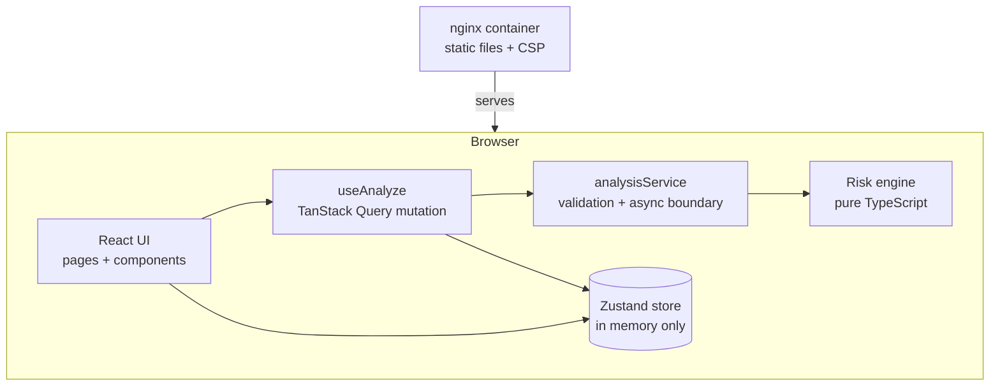
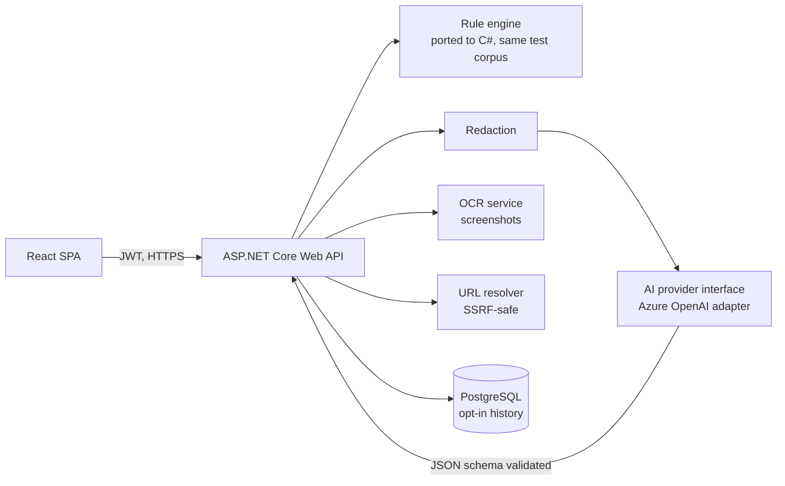

# Architecture and technical decisions

## Current state (phase 1)



The browser makes **no network requests** after loading the page. The production Content-Security-Policy enforces this with `connect-src 'none'`.

## Target state (phases 2–4)



## Folder structure

```
web/src/
├── components/       Shared UI with no domain knowledge (Button, Panel, SegmentedControl, ...)
│   ├── feedback/     Error boundary, empty/error state layout
│   ├── layout/       App shell, navigation, theme switcher
│   └── ui/
├── features/         Feature-based modules: everything about one feature lives together
│   ├── analysis/
│   │   ├── engine/   Pure risk engine (no React), fully unit-tested
│   │   ├── api/      Service layer: the only thing the UI calls to analyze
│   │   ├── hooks/    useAnalyze (TanStack Query mutation)
│   │   ├── store/    Zustand store for results and the analyzer draft
│   │   └── components/
│   ├── demo/         Scenarios (also the engine's calibration corpus)
│   └── url-inspector/
├── pages/            Route-level components: composition only, little logic
├── lib/              Framework-agnostic helpers
├── stores/           App-wide client state (theme)
└── styles/           Design tokens (CSS variables) and Tailwind setup
```

## Decisions and trade-offs

### The engine is pure TypeScript with no React
It can be tested in milliseconds without a DOM, reused by a Web Worker or a CLI, and ported to C# rule by rule. The demo scenarios and unit tests become the shared contract that proves the port behaves the same. *Trade-off:* the engine will exist in two languages for a while. It will move server-side, and the browser copy can then remain only for the offline demo.

### Deterministic rules first, AI second
An LLM alone cannot explain why it gave 73 instead of 68, can be prompt-injected by the very message it analyzes, costs money per call and changes behavior between model versions. The rule engine gives a reproducible, auditable baseline. AI will add a separate, labelled opinion and will not silently change the rule score. *Trade-off:* rules miss novel scams that AI could catch, which is why the confidence value is capped until AI review exists.

### The UI talks to a service, not the engine
`analyzeContent()` is async and validates input even though the engine is local today. When the .NET API arrives, only that function changes: components, hooks and tests stay the same.

### TanStack Query for the analysis call, even without a server
`useMutation` already provides pending and error states and gives a uniform pattern for server state. Phase 2 adds queries (history, dashboard) that need caching and invalidation, which is what this library is for. *Trade-off:* one dependency that is slightly ahead of today's needs.

### Zustand for client state, in memory only
The analyzer draft and results must survive navigation but **not** a reload: analysed messages can contain personal data, so they are never written to `localStorage`. Zustand gives a small, selector-based store without a provider tree. Only the theme preference is persisted, wrapped in a storage adapter that falls back to memory when storage is blocked.

### No `dangerouslySetInnerHTML`, ever
Highlights are computed as offsets and rendered as React text nodes with `<mark>` elements. A pasted `<script>` is displayed, not executed. A component test asserts this.

### Links are never fetched in the browser
Fetching a suspicious URL would confirm to the attacker that the message was opened and would expose the user's IP address. Domain age, reputation lookups and redirect resolution belong on a server with SSRF protection: an allow-list of schemes, a block on private IP ranges after DNS resolution, redirect limits and timeouts.

### Design tokens as CSS variables
Components use semantic names (`bg-surface`, `text-muted`), and light/dark mode is a token swap under `[data-theme]`. That keeps markup free of duplicated `dark:` classes. Every text token was measured against every surface for WCAG AA (4.5:1). A small inline script sets the theme before first paint, and the production CSP allows exactly that script by hash.

### Self-hosted fonts
Loading fonts from a third-party CDN would leak every page view of a privacy tool. They are bundled, and Vite is configured never to inline them as `data:` URIs, which the CSP would block.

### TypeScript 6 instead of 7
TypeScript 7 (the native compiler) is current, but `typescript-eslint` does not support it yet. Type-aware lint rules (`strictTypeChecked`) catch real bugs, so the project stays on TS 6 until the tooling catches up. Likewise, ESLint 9 is used because `eslint-plugin-jsx-a11y` does not support ESLint 10 yet.

### Strict TypeScript, beyond `strict`
`noUncheckedIndexedAccess` makes `array[i]` typed as possibly undefined, and `exactOptionalPropertyTypes` distinguishes "missing" from "undefined". Both caught real issues during development.
