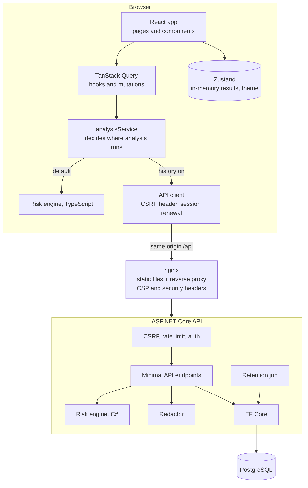

# Architecture and technical decisions

## The system



The decisive design choice is the **dashed line from the browser to the API: it exists only when the user has turned history on.** Everything else follows from treating a pasted message as sensitive data.

## Folder structure

```
web/src/
├── components/       Shared UI with no domain knowledge (Button, Panel, TextField, ConfirmDialog, ...)
├── features/         One folder per feature, everything about it together
│   ├── analysis/     engine/ (pure, no React), api/, hooks/, store/, components/
│   ├── auth/         session probe, forms, protected route
│   ├── history/      list, filters (URL state), rows
│   ├── demo/  url-inspector/
├── pages/            Route-level components: composition only
├── lib/              API client and small framework-agnostic helpers
└── stores/ styles/ test/

api/src/
├── TrustGuard.Engine/   Risk engine, no web dependencies
└── TrustGuard.Api/      Auth/, Analyses/ (incl. Redactor), Settings/, Data/ (+ Migrations), Infrastructure/

shared/engine/           Rule data and golden files read by both engines
```

## Decisions and trade-offs

### Two engines, one contract
The browser runs the TypeScript engine so a message never has to leave the device. The server runs a C# port so it can store results and add AI review. They read the same rules from `shared/engine/*.json`, and a **golden file** produced by the TypeScript engine pins every score, finding, span and explanation; the C# tests must reproduce it exactly, and CI fails if the golden file is stale. *Trade-off:* the logic exists twice. The cost is paid in tests, and the benefit is the privacy model.

### Where analysis runs is a privacy decision, not a quality one
Because both engines give identical results, the app can analyze in the browser by default and use the server only when saving is wanted. Every result screen states where it was produced, because a privacy claim nobody can see is worth little. If the server is unreachable while history is on, the app falls back to the browser and says so.

### Sessions in HttpOnly cookies, not `localStorage`
A token in `localStorage` can be read by any script that runs on the page, so one XSS bug becomes account takeover. `HttpOnly` cookies cannot be read by script at all. The cost of cookies is CSRF, handled in layers:
1. `SameSite=Strict`: the browser never attaches the cookies to a request started from another site.
2. A **double-submit token**: state-changing calls must echo the `tg_csrf` cookie in a header. A forged request cannot read the cookie.
3. An **`Origin` check** on every state-changing request, including sign-in (login CSRF).

The web server proxies `/api`, so the app and API share one origin: cookies are first-party, `Strict` works, and there is no CORS configuration to get wrong. *Trade-off:* the API is not callable from other websites by design. Non-browser clients use a Bearer header.

### Short-lived access token, rotating refresh token
A 15-minute JWT limits the damage of a leaked token. The refresh token is opaque, stored only as a SHA-256 hash, and **rotated on every use**. If a rotated token is presented again, someone has a copy, so the whole session family is revoked. Two tabs refreshing at once are not theft, so a reuse within 10 seconds of rotation returns `409 refresh_in_progress` and the client retries once; PostgreSQL's `xmin` guarantees that only one of two simultaneous refreshes can win. *Trade-off:* a stateful refresh table, in exchange for real logout and theft detection, which stateless JWTs cannot give.

### History is off by default, and storage is masked and layered
Three modes: nothing, a summary (score, level, indicator names), or a summary plus a copy with personal data masked. The server analyzes the **masked copy again** and stores that result, so what history shows is always consistent with what is stored. Stepping down a mode deletes what was stored, retention is user-chosen and enforced by a background job, and deleting the account cascades. *Trade-off:* a saved score can differ by a few points from the one shown at analysis time, because masking removes some tokens. A test pins the difference to a small bound and keeps critical messages critical. Redaction prefers over-masking, and keeps the email domain and link host on purpose, because those are the signals the engine needs.

### A hand-written WHATWG URL parser in C#
`System.Uri` normalizes hosts differently from browsers: `http://0x7f000001/` is `127.0.0.1` to a browser, and obfuscated IPs are exactly what attackers use. A small parser implements the WHATWG algorithm for hosts, IPv4 and IPv6 forms, ports, userinfo, dot segments and percent-encoding, and is verified against Node's `URL` on 148 inputs in CI-checked golden data. *Trade-off:* about 400 lines to own. Known gaps (Windows drive letters in `file:` URLs, the full IDNA validity tables) are documented in the file.

### Regex semantics are translated, not assumed
The rules are JavaScript regular expressions. In .NET, `\b`, `\w` and `\d` are Unicode-aware, `\s` covers a different set, and `.` excludes fewer characters. A direct port scores 6 of 105 test messages differently (for example, "verify" next to a Turkish letter is not matched). A translation layer maps each construct to its exact JavaScript meaning, and probes in the golden file fail if it is removed.

### Deterministic rules first, AI second
An LLM alone cannot explain why it gave 73 instead of 68, can be prompt-injected by the message it analyzes, costs money per call and changes behavior between model versions. The rule engine gives a reproducible, auditable baseline. AI will add a separate, labelled opinion on masked text and will not silently change the rule score. *Trade-off:* rules miss novel scams, which is why confidence is capped while AI review does not exist.

### Scoring that can be explained
Findings combine with a noisy-OR, `risk = 1 − ∏(1 − wᵢ)`: the score stays within 0 to 100, one strong signal beats many weak ones, and a repeated phrase counts once. Points are attributed to findings in log space and rounded so that they add up to the displayed score exactly, which a test asserts. See [risk-engine.md](risk-engine.md).

### Bounded, hostile-input-safe by construction
User text is untrusted. Property-based tests throw thousands of random inputs at both engines and assert invariants (no crash, points sum to the score, highlights rebuild the text, output is valid UTF-8 and JSON). That found three real crashes during development: a stray `%` in a link, an out-of-range Punycode label, and an emoji cut in half at the length limit. Regexes are bounded and have a two-second match timeout on the server.

### One error contract
Every failure is `application/problem+json` with a stable `code`, in every environment (the framework's default differs between Development and Production, so it is forced). The web client maps codes, not message strings, to behavior. Internal details never reach the client.

### State management
- **Server state** (session, history) lives in TanStack Query: caching, retries and invalidation come for free.
- **Client state** (the draft, fresh results, theme) lives in Zustand. Results are **never persisted**: a reload clears them, because they may contain personal data.
- **Filters live in the URL**, so a filtered view can be shared, the back button steps through changes, and a reload keeps place. Controls bound to the URL keep a local copy that updates instantly, because navigation is asynchronous and a checkbox bound directly to it flickers.

### Sign-out goes through a route
Clearing the session while a protected page is still mounted lets that page see "no user" and redirect to sign-in, racing the navigation home. This showed up as a flaky end-to-end test that failed in about a third of runs. Sign-out and account deletion now navigate to a `session-ended` route first and clear the session there, so the protected page is gone before the session is. The flow then passed 24 of 24 runs.

### Containers
Non-root users, read-only root filesystems, dropped capabilities and `no-new-privileges`. The database sits on a network only the API shares, and only the web server is published, on `127.0.0.1`. nginx forwards the `Host` header **with its port**: the API compares it with the browser's `Origin` for CSRF, and dropping the port would reject every request not on port 80 or 443. The Content-Security-Policy allows scripts only from the page itself plus one hashed inline script (the theme bootstrap), and `connect-src 'self'`.

### Smaller decisions
- **Minimal APIs, not controllers:** endpoints stay short and grouped by feature, with validation, rate limits and OpenAPI declared next to each route.
- **EF Core with explicit SQL-friendly mapping:** snake_case names, readable enums, indexes and `CHECK` constraints declared in the model.
- **Migrations on startup are opt-in.** Convenient for one instance; with several replicas, run them as a separate step.
- **In-memory rate limiting** is per instance. Scaling out needs a shared store (Redis), noted as a limitation.
- **Self-hosted fonts and no analytics:** a privacy tool should not tell a third party which pages you opened.
- **TypeScript 6 and ESLint 9** rather than the newest majors, because `typescript-eslint` and `eslint-plugin-jsx-a11y` do not support the newest ones yet. Type-aware lint rules and accessibility rules are worth more than the version number.
