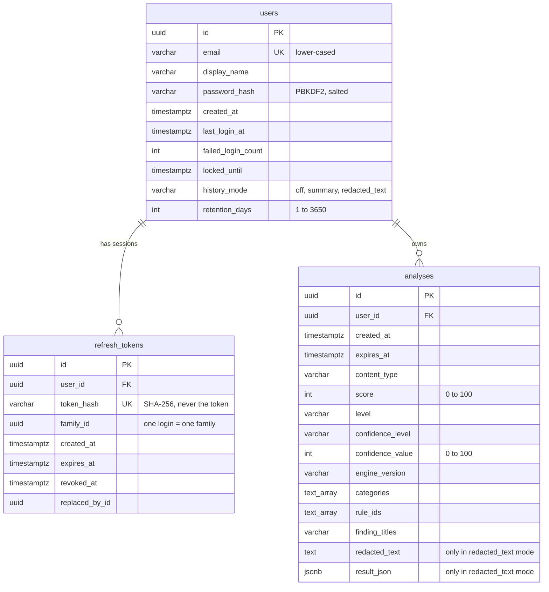

# Database

PostgreSQL 18. The schema is created by EF Core migrations ([`api/src/TrustGuard.Api/Data/Migrations`](../api/src/TrustGuard.Api/Data/Migrations)); [`db/schema.sql`](../db/schema.sql) is the same schema as one idempotent SQL script, so it can be applied with `psql` or pasted into a SQL editor without the .NET SDK.



## Design notes

- **UUIDv7 keys**, generated in the application. They are time-ordered, so inserts append to the index instead of scattering across it.
- **`timestamptz` everywhere**, always UTC.
- **Enums as readable `varchar`** with the API's snake_case names. A plain `SELECT` is self-explanatory, and adding a value needs no `ALTER TYPE`.
- **`text[]` for categories and rule ids**, **`jsonb` for the stored result**. The result is read back whole and never queried inside, so `jsonb` buys validation and compactness without a normalized child table.
- **`finding_titles`** denormalizes the indicator names into one searchable column, so history search works even when no message text is stored.
- **`CHECK` constraints** keep scores in 0 to 100 and retention in 1 to 3650 days, whatever the application does.
- **`ON DELETE CASCADE`** from `users`: deleting an account removes its sessions and every saved analysis in one statement. A test asserts that no orphans remain.
- **Optimistic concurrency** on `refresh_tokens` through PostgreSQL's `xmin`: two simultaneous refreshes of one token cannot both succeed. No extra column exists in the table.

## Indexes and why

| Index | Serves |
|---|---|
| `users (email)` unique | Sign-in lookup, duplicate prevention |
| `analyses (user_id, created_at DESC)` | The default history list: one user's newest analyses first, read straight from the index |
| `analyses (user_id, level, created_at DESC)` | The same list narrowed by risk level. Equality column first, sort column last, so no separate sort step |
| `analyses (expires_at)` | The retention job deletes by expiry across all users |
| `refresh_tokens (token_hash)` unique | Refresh lookup |
| `refresh_tokens (family_id)` | Revoking a whole session family on token reuse |
| `refresh_tokens (user_id, expires_at)` | Cleanup of a user's old sessions |

## Try it

Run these in a SQL editor against a database with some saved analyses.

```sql
-- Is the history list served by the index? Look for "Index Scan using ix_analyses_user_id_created_at".
EXPLAIN ANALYZE
SELECT id, score, level, created_at
FROM analyses
WHERE user_id = (SELECT id FROM users LIMIT 1)
ORDER BY created_at DESC
LIMIT 10;

-- Same list filtered by level: should use ix_analyses_user_id_level_created_at.
EXPLAIN ANALYZE
SELECT id, score, created_at
FROM analyses
WHERE user_id = (SELECT id FROM users LIMIT 1) AND level IN ('high', 'critical')
ORDER BY created_at DESC
LIMIT 10;

-- What does the database actually hold for one analysis? (Never the original message.)
SELECT level, categories, left(finding_titles, 80) AS titles, redacted_text
FROM analyses
ORDER BY created_at DESC
LIMIT 3;
```

On a nearly empty table PostgreSQL may prefer a sequential scan. Add a few hundred rows, or run `SET enable_seqscan = off;` to see the index plan.

## Migrations

Create one after changing the model:

```bash
cd api
dotnet ef migrations add <Name> --project src/TrustGuard.Api --output-dir Data/Migrations
```

Regenerate the SQL script:

```bash
dotnet ef migrations script --idempotent --project src/TrustGuard.Api --output ../db/schema.sql
```

Apply to a database: start the API with `Database__MigrateOnStartup=true`, or `dotnet ef database update`. Use a **direct** (non-pooled) connection for migrations: connection poolers cannot hold the advisory lock EF Core takes. Npgsql pools connections inside the API, so the API itself does not need a pooler.
