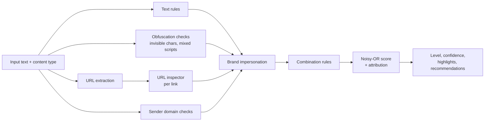

# Risk engine

The risk engine is a pure TypeScript module ([`web/src/features/analysis/engine`](../web/src/features/analysis/engine)) with no React, DOM or network dependencies. It turns a piece of text into an explainable `AnalysisResult`. It is deterministic: the same input always gives the same score.

## Pipeline



1. **Text rules** ([`rules.ts`](../web/src/features/analysis/engine/rules.ts)): regular expressions grouped into named rules. A rule contributes **at most once**, so repeating "URGENT" ten times does not raise the score.
2. **Obfuscation checks**: invisible characters (zero-width space, soft hyphen, BOM) and words that mix Latin with Cyrillic or Greek letters.
3. **URL inspection** ([`url.ts`](../web/src/features/analysis/engine/url.ts)): every link is parsed with the WHATWG `URL` parser (the same parser the browser uses) and checked structurally. Links are **never fetched**.
4. **Sender checks**: the domain of any email address is run through the look-alike checks (`service@paypa1-support.com`).
5. **Impersonation**: a brand mentioned in the text, combined with a link to a domain that brand does not own, or with a request for data or money.
6. **Combination rules**: some patterns are much stronger together than apart, for example a job offer that also asks for a fee.

## Scoring

Each finding has a weight `w` between 0 and 1. Findings are combined with a **noisy-OR**:

```
risk  = 1 − ∏ (1 − wᵢ)
score = round(100 × risk)
```

Why noisy-OR rather than a sum:

| Property | Sum of points | Noisy-OR |
|---|---|---|
| Stays within 0–100 without clamping | No | Yes |
| Adding evidence never lowers the score | Yes | Yes |
| One strong signal beats several weak ones | No | Yes |
| Many weak signals saturate instead of reaching 100 | No | Yes |

| Score | Level |
|---|---|
| 0–24 | Low |
| 25–49 | Moderate |
| 50–74 | High |
| 75–100 | Critical |

### Explaining the score

In log space noisy-OR is additive: `−ln(1 − risk) = Σ −ln(1 − wᵢ)`. Each finding therefore receives a share of the points proportional to `−ln(1 − wᵢ)`. Largest-remainder rounding keeps the integer points **summing exactly to the displayed score**, which the unit tests assert. This is what powers the "+17 pts" labels and the score breakdown bar.

### Confidence

Confidence measures **how much evidence the engine had**, not how dangerous the content is. It goes up with longer text, several independent indicator types and strong specific signals. It goes down for very short text and mixed signals, and it is capped at 85% while the engine runs without AI review. A 10-word message with no findings is therefore *low risk, low confidence*, which is the honest answer.

## Text rules

Weights are hand-calibrated heuristics, not measured probabilities. The [demo scenarios](../web/src/features/demo/scenarios.ts) act as a calibration corpus: a test fails if any scenario changes risk level.

| Rule | Category | Title | Weight | Content-type boost |
|---|---|---|---|---|
| `urgency.deadline` | Urgency & pressure | Artificial deadline | 0.18 | – |
| `urgency.threat` | Urgency & pressure | Threat of consequences | 0.22 | – |
| `urgency.secrecy` | Urgency & pressure | Request for secrecy | 0.22 | – |
| `phishing.credentials` | Credential phishing | Asks you to sign in or verify your account | 0.32 | – |
| `phishing.click_prompt` | Suspicious link | Pushes you to click a link | 0.08 | – |
| `phishing.generic_greeting` | Credential phishing | Generic greeting | 0.08 | – |
| `personal_info.otp` | Personal data request | Asks for a one-time code | 0.55 | – |
| `personal_info.sensitive` | Personal data request | Asks for sensitive personal data | 0.35 | – |
| `advance_fee.payment` | Upfront payment | Asks you to pay a fee first | 0.32 | – |
| `advance_fee.untraceable` | Upfront payment | Untraceable payment method | 0.4 | – |
| `fake_job.too_easy` | Fake job offer | Job that sounds too easy | 0.25 | job_offer ×1.3, whatsapp ×1.2 |
| `fake_job.off_platform` | Fake job offer | Moves you to a private chat | 0.28 | job_offer ×1.3 |
| `fake_job.equipment` | Fake job offer | Equipment or check payment scheme | 0.45 | job_offer ×1.2 |
| `earnings.unrealistic` | Unrealistic earnings | Unrealistic earnings promise | 0.3 | job_offer ×1.2 |
| `earnings.prize` | Unrealistic earnings | Prize or reward you did not enter for | 0.32 | – |
| `crypto.investment` | Unrealistic earnings | Crypto investment pitch | 0.2 | – |
| `delivery.failed` | Credential phishing | Parcel delivery problem | 0.2 | sms ×1.2 |

## URL checks

| Check | Signal | Weight |
|---|---|---|
| Dangerous scheme | `javascript:`, `data:`, `vbscript:`, `file:` | 0.70 |
| Look-alike brand | Homoglyphs / digit swaps (`paypa1`, `rnicrosoft`) | 0.60 |
| Look-alike brand | Typo-squat (edit distance 1–2, brand names ≥ 6 chars) | 0.50 |
| Look-alike brand | Brand as a prefix, suffix or token of another domain | 0.50 |
| Look-alike brand | Brand only in the subdomain (`paypal.com.evil.net`) | 0.50 |
| Private / obfuscated IP | `192.168.x.x`, `0x7f000001` | 0.50 |
| Hidden destination | Text before `@` (`https://bank.com@evil.net`) | 0.45 |
| Mixed-script punycode | `xn--` domain mixing alphabets | 0.45 |
| Raw IP host | Public IPv4/IPv6 instead of a name | 0.35 |
| URL shortener | Destination hidden | 0.20 |
| Punycode | Internationalized domain, single script | 0.20 |
| Plain HTTP | Only when a scheme is actually present | 0.15 |
| High-abuse TLD | `.xyz`, `.top`, `.zip`, ... | 0.15 |
| Deep subdomains | 3+ levels | 0.15 |
| Login wording | `login`, `verify`, `account` on a non-official host | 0.12 |
| Hyphen-heavy name | 2+ hyphens in the registrable name | 0.10 |
| Custom port | Any explicit port | 0.10 |

Ownership is always reported in the ASCII (punycode) form, such as `xn--pypal-4ve.com`. The Unicode display form (`pаypal.com`) is shown only as a warning, with non-Latin letters marked.

## False-positive guards

Specific tests protect against over-flagging: `purchase.com` must not match "chase", `pineapple.com` must not match "apple", ordinary sender domains are ignored, and an official Netflix link in a Netflix message is not impersonation.

## Two engines, one contract

The same engine exists in TypeScript (browser) and C# (server). Rule data is shared in [`shared/engine`](../shared/engine) and validated when it loads. Correctness across languages is enforced by golden files, not by hope:

| File | Produced by | Asserted by |
|---|---|---|
| `parity-cases.json` | hand-written inputs | both |
| `parity-expected.json` | the TypeScript engine (`npm run golden`) | the C# engine, the TypeScript engine, and CI (stale file fails the build) |
| `url-parse-cases.json` and `url-parse-expected.json` | Node's `URL` implementation | the C# URL parser |

The expected file compares scores, findings, evidence, spans, points, categories, highlights, recommendations, confidence and every URL check.

What had to be handled explicitly to make results identical:

- **Regex semantics.** A translation layer maps `\b`, `\d`, `\s`, `\w` and `.` to their JavaScript meaning. Probe messages (a Turkish letter before "verify", Arabic-Indic digits, `U+FEFF`, `U+2028`) fail on a plain port.
- **Rounding.** `Math.round` rounds halves up; .NET rounds to even by default.
- **Sorting.** JavaScript's sort is stable, and so are the LINQ ordering calls used in C#. `List.Sort` is not.
- **String comparison.** All comparisons are ordinal. Culture-sensitive comparison silently ignores zero-width characters, which is exactly what attackers insert. This is enforced as a build error.
- **Unicode.** Script detection uses an explicit range table in both languages instead of `\p{Script=...}`. Input is normalized (line endings, unpaired surrogates) the same way on both sides.
- **URL parsing.** A WHATWG parser in C#, checked against Node on 148 URLs.

### Known divergences

- JavaScript's `u`-flag regexes count astral characters (emoji) as one unit inside bounded quantifiers such as `.{0,40}`; .NET counts UTF-16 units. A window at the boundary can differ. The golden file includes emoji cases and they match.
- `ToLowerInvariant` and `toLowerCase` can differ for a few special characters (for example Turkish dotted `İ`).
- The IDNA validity check is an approximation of the full UTS 46 tables.
